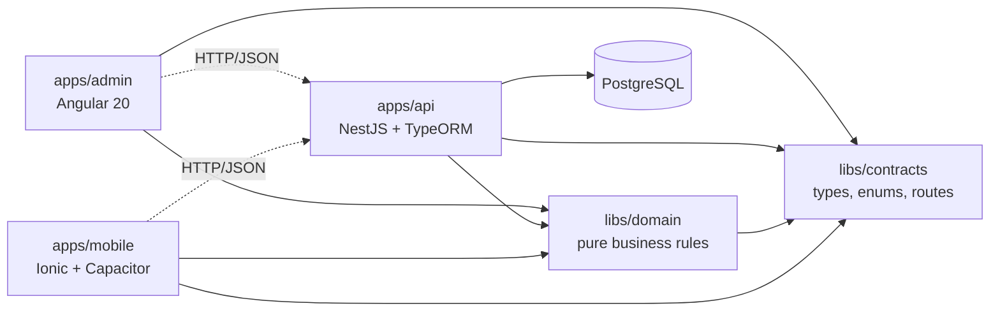
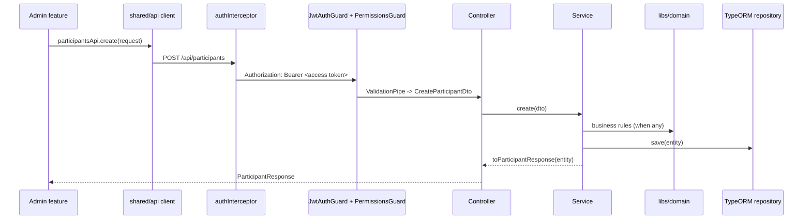

# Architecture

Junta is an Nx monorepo with three applications and two shared libraries.

| Project              | Nx name               | Tags                             |
| -------------------- | --------------------- | -------------------------------- |
| `apps/api`           | `@junta/api`          | `type:app`, `scope:api`          |
| `apps/admin`         | `@junta/admin`        | `type:app`, `scope:admin`        |
| `apps/mobile`        | `@junta/mobile`       | `type:app`, `scope:mobile`       |
| `libs/contracts`     | `@junta/contracts`    | `type:contracts`, `scope:shared` |
| `libs/domain`        | `@junta/domain`       | `type:domain`, `scope:shared`    |
| `tools/nx-plugin`    | `@junta/nx-plugin`    | `type:tool`, `scope:tooling`     |
| `tools/eslint-rules` | `@junta/eslint-rules` | `type:tool`, `scope:tooling`     |

Every project has `lint`, `typecheck` and, where it has logic, `test`. The apps
add `build` and `serve`, and the API adds `e2e`.

## Why two shared libraries

- **`libs/contracts`** holds the wire format: request and response types,
  enums and the `ApiResource` route names. The API DTOs `implements` these
  types and the admin clients return them, so a contract change breaks the
  compile on both sides at once. It contains no runtime logic and imports no
  package.
- **`libs/domain`** holds business rules as pure functions: group amounts,
  group assignment validation, month counting, the raffle and the role policy.
  Each function cites its rule id and has tests. Both apps can call it, so the
  admin form and the API agree by construction. It imports only contracts.

There are no repository ports, use-case classes or per-entity libraries. At
this size those layers cost more in indirection than they return, see
[ADR 0002](decisions/0002-contracts-and-domain-libraries.md).

## Request flow

On a 401 the interceptor refreshes the access token once and retries. If the
refresh fails, the session ends and the admin returns to `/login`.

## Authentication and authorization

- `POST /api/auth/login` checks email and password and returns an access
  token. It also sets the refresh token as an http-only cookie.
- Access tokens carry `sub`, `email`, `roles` and `permissions`, plus
  `type: 'access'`. Refresh tokens carry only `sub` and `type: 'refresh'`.
  Each strategy rejects the other type.
- `POST /api/auth/refresh` reloads the admin from the database, so role changes
  and deletions apply at the next refresh.
- `POST /api/auth/logout` clears the cookie and ends every session of its
  admin. Refresh tokens carry the admin's `tokenVersion`. Logout and password
  changes increment it, which revokes every earlier refresh token, see
  [spec 002](specs/002-refresh-token-revocation.md). Access tokens live one
  minute and are not revoked.
- Login, refresh and logout refuse requests whose `Origin` is not in
  `CORS_ORIGIN` (`CookieOriginGuard`), because the refresh cookie is
  `SameSite=None` and a form on another site could otherwise post to them.
- Every route requires an access token unless decorated with `@Public()`.
  `@RequirePermissions(...)` checks the token's permissions. Roles map to
  permissions in `libs/domain` (BR-12).
- The admin mirrors these checks for usability only: `permissionGuard` on
  routes and `*jaHasPermission` in templates. The API is the authority.

## Errors

| Status | Cause                                                     |
| ------ | --------------------------------------------------------- |
| 400    | Validation failure, or a business rule with its `rule` id |
| 401    | Missing, expired or wrong-type token                      |
| 403    | Missing permission                                        |
| 404    | Unknown id                                                |
| 409    | Unique or foreign-key conflict                            |

The admin shows the API message for business rule errors through
`apiErrorMessage()`.

## Persistence

- PostgreSQL through TypeORM. The entities in
  `apps/api/src/app/**/entities/` are the only schema definition, see
  [ADR 0003](decisions/0003-entities-are-the-schema.md).
- Migrations in `apps/api/src/app/database/migrations/` change the schema in
  every environment, see [ADR 0005](decisions/0005-migrations.md). They are
  generated from the entities, and the e2e suite fails when the two differ.
  The API refuses to start while migrations are pending.
- Configuration comes from environment variables loaded by Nx from
  `apps/api/.env`. See `apps/api/.env.example`.

## Admin application

- Every page is lazy-loaded, including the layout shell. Route params bind to
  page inputs.
- A page is a set of independent features (`list-feat`, `create-feat`, ...)
  that communicate through a page-scoped signal store, see
  [ADR 0004](decisions/0004-admin-pages-and-features.md).
- `shared/api` holds one client per API resource. It is the only HTTP code.
- Change detection is zoneless. State is signals; every component is OnPush.

## Mobile application

- The app for participants on iOS and Android, see
  [ADR 0006](decisions/0006-hybrid-mobile-app.md) and
  [spec 003](specs/003-participant-mobile-app.md). Angular 20 with Ionic 9
  components, zoneless and signal-based like the admin. Capacitor 8 wraps the
  web build in native iOS and Android projects.
- Same structure as the admin: lazy pages made of features, one `shared/api`
  client per resource, `jm-` selectors.
- `npm run start:mobile` serves it in the browser and proxies `/api` to the
  local API. Native builds will call the API by the absolute URL in
  `apps/mobile/src/environments/environment.ts`. Their origins must not join
  `CORS_ORIGIN`: that list grants access with the refresh cookie, and
  `https://localhost` is not unique to this app. Spec 003 decides how native
  builds call the API.
- The native projects get added once the app id is decided. From then on they
  are committed source.
- Participants cannot sign in yet. The admin's refresh cookie does not suit
  native apps, so spec 003 decides the participant sign-in.

## How the rules are enforced

| Rule                                                                | Enforced by                                                    |
| ------------------------------------------------------------------- | -------------------------------------------------------------- |
| Library dependency directions, no app-to-app imports                | `@nx/enforce-module-boundaries` in `.eslintrc.json`            |
| Contracts import nothing, domain imports no framework               | `bannedExternalImports` in `.eslintrc.json`                    |
| Controllers hold no persistence or business logic                   | `no-restricted-imports` in `apps/api/.eslintrc.json`           |
| Pages of an app never import each other                             | `@nx/workspace-no-cross-page-imports` (`tools/eslint-rules`)   |
| Pages never use `HttpClient`                                        | `no-restricted-imports` in each Angular app's `.eslintrc.json` |
| Signals, OnPush, `inject()`, `ja-` or `jm-` prefix, control flow    | angular-eslint rules in each Angular app's `.eslintrc.json`    |
| Strict types, no `any`, explicit return types, no floating promises | `tsconfig.base.json` and the root ESLint config                |
| API shapes match on both sides                                      | DTOs and clients typed with `@junta/contracts`                 |
| New resources follow the canonical layout                           | `@junta/nx-plugin` generators and their snapshot tests         |
| Generators keep producing working code                              | The `Generators` CI job builds and tests a generated resource  |
| Formatting                                                          | Prettier, the format-on-edit hook and `nx format:check`        |
| Work is verified before it is reported done                         | `tools/scripts/verify.mjs`, the agent stop hooks and CI        |
